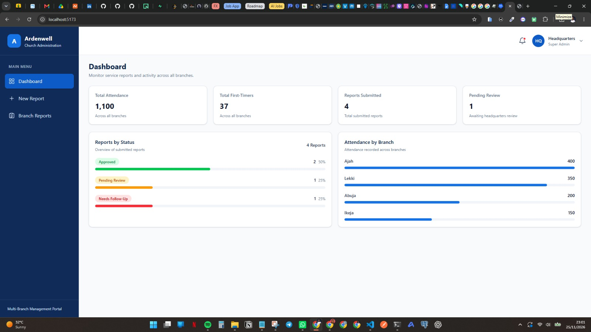
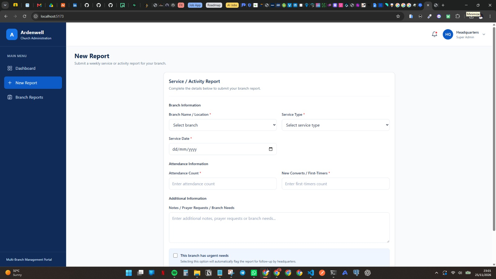
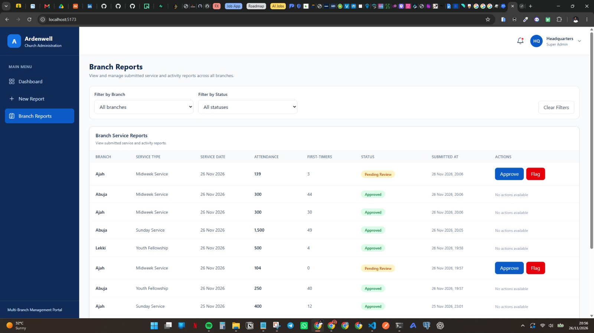

# Ardenwell Church Administration Portal

A web application for managing service reports across multiple church branches. It helps branches submit reports and gives headquarters one place to review attendance, track first-timers, and manage submitted reports.

## About the Project

I built this application to make branch reporting easier to manage.

Each branch can submit its service details, including attendance, first-timers, notes, and urgent needs. The backend checks the submitted information and assigns an initial status.

Headquarters can view all submitted reports, filter them by branch or status, and approve or flag reports that are still pending review.

## What the Application Does

- Allows branches to submit service reports.
- Checks submitted information on the frontend and backend.
- Assigns an initial status to each report.
- Shows total attendance and first-timer figures on the dashboard.
- Displays reports from different branches.
- Filters reports by branch and status.
- Allows headquarters to approve or flag pending reports.
- Stores submitted reports in an SQLite database.

## Technologies Used

| Area | Technology |
|---|---|
| Frontend | React, TypeScript, Vite |
| Styling | Tailwind CSS |
| Backend | Python, Flask |
| API Support | Flask-CORS |
| Database | SQLite |
| Testing | Python unittest |

## Project Structure

```text
ardenwell-church-admin-portal/
├── backend/
│   ├── tests/
│   │   └── test_app.py
│   ├── app.py
│   ├── db.py
│   ├── reports_repository.py
│   ├── triage.py
│   └── requirements.txt
│
├── src/
│   ├── components/
│   ├── data/
│   ├── features/
│   │   └── reports/
│   ├── pages/
│   ├── services/
│   ├── App.tsx
│   ├── index.css
│   └── main.tsx
│
├── AI_USAGE.md
├── project_plan.md
├── README.md
└── package.json
```

## Getting Started

You need the following installed:

- Node.js and npm
- Python
- Git

### 1. Clone the repository

```bash
git clone https://github.com/onumaeleanyagift/ardenwell-church-admin-portal
cd ardenwell-church-admin-portal
```

### 2. Set up the backend

Create a virtual environment from the project root:

```powershell
py -m venv .venv
```

Activate it:

```powershell
.\.venv\Scripts\Activate.ps1
```

Install the Python dependencies:

```powershell
pip install -r backend/requirements.txt
```

### 3. Set up the frontend

Open another terminal in the project root and run:

```bash
npm install
```

## Running the Application

You need two terminals to run the application.

### Start the backend

In the first terminal, activate your virtual environment if it is not already active.

From the project root, run:

```bash
python backend/app.py
```

The backend runs at:

```text
http://127.0.0.1:5000
```

To check that it is running, open:

```text
http://127.0.0.1:5000/api/health
```

### Start the frontend

In the second terminal, run:

```bash
npm run dev
```

Open the local URL shown in your terminal. By default, Vite uses:

```text
http://localhost:5173
```

Keep both terminals running while using the application.

## API Endpoints

These are the endpoints I implemented:

| Method | Endpoint | What it does |
|---|---|---|
| GET | `/api/health` | Checks whether the backend is running. |
| POST | `/api/reports` | Submits a new branch report. |
| GET | `/api/reports` | Retrieves submitted reports. |
| PATCH | `/api/reports/{id}/status` | Approves or flags a pending report. |

## How Report Statuses Work

The backend assigns an initial status using these rules:

| Condition | Initial Status |
|---|---|
| Urgent needs flagged | Needs Follow-Up |
| Attendance below 100 | Needs Follow-Up |
| Youth Fellowship | Pending Review |
| Attendance of 300 or more | Approved |
| Other reports | Pending Review |

The backend checks these rules in that order. For example, a Youth Fellowship report with attendance of 300 or more still receives Pending Review.

I used these thresholds as sample rules for the project. They can be changed to match the church's actual reporting requirements.

## Running the Tests

I used Python's built-in `unittest` framework for the backend tests.

From the project root, move into the backend folder:

```bash
cd backend
```

Run:

```bash
python -m unittest discover -s tests -v
```

The seven tests cover:

1. Submitting a valid report.
2. Assigning Needs Follow-Up when attendance falls below the threshold.
3. Rejecting negative attendance.
4. Rejecting a report with no branch name.
5. Approving a pending report.
6. Flagging a pending report.
7. Preventing another status update after a report has already been decided.

Return to the project root:

```bash
cd ..
```

## Building the Frontend

To check the frontend build, run this from the project root:

```bash
npm run build
```

## Using the Application

1. Start the backend and frontend.
2. Open the application in your browser.
3. Check the dashboard for attendance and report summaries.
4. Open the New Report page.
5. Select a branch and service type.
6. Enter the service date, attendance, and first-timer count.
7. Add notes or indicate urgent needs where necessary.
8. Submit the report.
9. Open the Reports page to view the report and its status.
10. Use the headquarters actions to approve or flag pending reports.

## Database

I used SQLite to store the reports.

The database file is created locally at:

```text
backend/ardenwell.db
```

Git ignores this file, so it does not form part of the repository. Each local installation creates its own database when the backend starts.

## Screenshots

### Dashboard


### New Report Form


### Reports Page


## Current Limitations

- The application currently runs locally.
- User authentication and role-based access control are not implemented.
- The headquarters approval controls do not enforce actual user permissions.
- The report triage thresholds are sample rules.

## Author

Developed as part of the IBOSS Junior Engineering Practical Assignment.